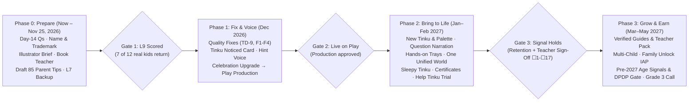

# IMPROVEMENT_PLAN.md — Final Reconciled Improvement Plan (v2)

> **Scope (Single Source of Truth):** Final reconciled, code-verified post-`L9` improvement plan synthesizing independent reviews against live `src/` and locked decisions. Covers verified defects, positioning, brand/IP/trademark foundations, voice-first & tactile UX, a gated 4-phase solo-founder roadmap, zero-analytics organic growth, `2026-10-20`-compliant parent-convenience IAP, and pre-2027 Age Signals / DPDP compliance gates.
> - Active UX follow-ups (`F1`–`F5`), design-system proposals (`DS-1`–`DS-8`), teacher sign-offs (`☐ 1`–`☐ 17`), and Layer 2 triggers live in [`ROADMAP.md`](ROADMAP.md).
> - Live release status, Play Data Safety answers, and the active `L9` closed-test protocol live in [`CURRENT_STATE.md`](CURRENT_STATE.md).
> - Code-level defects, stale flags, boundary breaches, lint warnings, and test gaps (`TD-1`–`TD-9` — all resolved as of `2026-11-23`) live in [`TECH_DEBT.md`](TECH_DEBT.md).
> - Historical decisions (including the locked `2026-10-20` monetisation rule) live in [`archive/decisions/DECISIONS.md`](archive/decisions/DECISIONS.md).

_Reconciled: `2026-11-20` · Web/master implementation updated: `2026-11-21` (during `L9` closed test — **Android Play release remains frozen until `L9` is scored `~2026-11-25`**)._

---

## 1. Where Tinku Math Stands (Code-Verified Audit)

The engineering and teaching engine are unusually rigorous, while the visible brand and surface read like a clean template. Every finding below was verified directly in live code:

| Area | Verified Finding | Evidence |
|---|---|---|
| **Teaching engine** | 36 `ready` skills, 85 diagnostic misconception tags with targeted hints, spaced review, and a never-punish remediation path. | [`src/recipes/skillMap.js`](src/recipes/skillMap.js), [`src/engine/hints.js`](src/engine/hints.js) |
| **Mistake data** | Each child's mistakes are counted by type on-device (`misconceptions: { tag: count }`). **Update (`2026-11-21`):** Now surfaced in [`ParentDashboard.jsx`](src/components/ParentDashboard.jsx) via the **"Tinku Noticed"** card (`84/84` diagnostic coaching tips in [`parentCoaching.js`](src/engine/parentCoaching.js)). | [`src/engine/mastery.js`](src/engine/mastery.js) (`:52`, `:129-132`), [`src/engine/parentCoaching.js`](src/engine/parentCoaching.js) |
| **Privacy** | Zero accounts, ads, analytics, or network calls; zero Android OS permissions verified on a real phone. | [`CURRENT_STATE.md`](CURRENT_STATE.md), [`src/services/__tests__/androidProject.test.js`](src/services/__tests__/androidProject.test.js) |
| **Engineering** | `67` test files (`874` passed / `876` total), `0` ESLint errors/warnings, and CI guards enforcing privacy, brand, and colour tokens. | [`CURRENT_STATE.md`](CURRENT_STATE.md) |
| **Character** | Tinku reads as a generic flat cartoon elephant: 6 static images, no animation, unused `Tinku_Sleeping.webp`, and unclear AI-art copyrightability. | `branding/`, [`src/components/Mascot.jsx`](src/components/Mascot.jsx) (`:34`) |
| **Colour** | Default Wonder palette uses Tailwind's stock indigo and sky (`#4f46e5`, `#3730a3`, `#e0e7ff`, `#f0f9ff`). | [`src/index.css`](src/index.css) (`:38-64`) |
| **Icons & names** | **Update (`2026-11-21`):** Replaced repeating emojis and `🐘` with `36/36` kid-first token-coloured SVG medallions ([`SkillIcon.jsx`](src/components/SkillIcon.jsx)), renamed `Bigger or Smaller?` → `More or Fewer?`, and removed the duplicate Home Tinku. | [`src/components/SkillIcon.jsx`](src/components/SkillIcon.jsx), [`src/recipes/skillMap.js`](src/recipes/skillMap.js), [`src/components/SkillPathScreen.jsx`](src/components/SkillPathScreen.jsx) |
| **Reading barrier** | Zero voice recordings bundled yet. **Update (`2026-11-21`):** All 85 hints shortened to `<= 10` crisp spoken words (guarded in `hints.test.js`); one-way `playHintVoice(tag)` / `stopHintVoice()` / `hasHintVoice(tag)` playback scaffold (`sound.js`), `hintTag` plumbing (`useQuizSession.js`), and `48 dp` **"Listen to hint"** button (`HintBubble.jsx`) shipped with chime fallback. **Speaker button is intentionally hidden via `hasHintVoice(tag)` until `.opus` clips are bundled into `src/assets/audio/hints/`.** | [`src/engine/hints.js`](src/engine/hints.js), [`src/services/sound.js`](src/services/sound.js), [`src/components/HintBubble.jsx`](src/components/HintBubble.jsx) |
| **Interaction** | Every skill ends in tapping 1 of 3–4 rectangular MCQ tiles. | [`RECIPE_TEMPLATE.md`](RECIPE_TEMPLATE.md) |
| **Celebration** | **Update (`2026-11-21`):** Replaced raw emoji stars with SVG Spark stars, added skill name context + `MasteryPips`, and promoted **"Next with Tinku →"** on level-up/mastery. | [`src/components/CelebrationScreen.jsx`](src/components/CelebrationScreen.jsx) |
| **Verified Bugs (`TD-9`)** | **Fixed (`2026-11-20`):** Removed `group-compare` count leaks with big-vs-small glyph contrast and removed `half-collection` `({groupSize})` numeral leaks, guarded in `QuestionView.test.jsx`. | [`src/components/QuestionView.jsx`](src/components/QuestionView.jsx) (`:734-785`), [`TECH_DEBT.md`](TECH_DEBT.md) |
| **Layout** | **Update (`2026-11-21`):** Child/parent `>= 48 dp` tap targets (`F1` + `check-quiz-layout.mjs` guard, `F2`), `F3` (`ParentDashboard` at `360×640` verified in Playwright), `F4` (centred tablet layout), and `stage` mascot height tuning (`25cqh → 20cqh`, `19cqh` at `<= 600px`) shipped. | [`ROADMAP.md`](ROADMAP.md) (`F1`–`F4`), [`src/index.css`](src/index.css) (`:237-273`) |

---

## 2. Positioning & Brand Identity

### Core Promise & Rules
- **One-sentence promise:** **"The calm maths friend who knows why your child is stuck, and never makes them feel small."** *(Short tagline: **"The maths friend that knows why."**)*
- **Permanent Trust Line:** **`No ads · No trackers · No accounts · Works offline.`** *(Deliberately omits `"zero permissions"` so adding Play Billing later never breaks the brand promise.)*
- **Proof points:** 85 diagnostic mistake patterns (*"knows why"*) + never-punish remediation (*"never feel small"*).
- **Never list:** No streaks, gem/coin grind economies, leaderboards, countdown timers, ads, accounts, or paid gating of learning.
- **Name & spelling:** Keep **"Tinku"**. Settle `"Math"` vs. `"Maths"` for the product name and keep the other as a Play Store keyword (as `Tinku Math: Maths for Kids` already does).
- **Trademark check:** Run a formal trademark search in **India** (specifically against **Tinkle** / Amar Chitra Katha across Classes 9, 16, 41, 42), **UAE**, and target markets **before** production launch and marketing spend.
- **Market stance:** Marketing leads with India and UAE parents; the app itself stays region-neutral. No `"CBSE"` claims on app or web unless the owner explicitly amends [`AGENTS.md`](AGENTS.md) §2.

### Six Brand Identity Levers
1. **Human-Illustrated Character & Full IP Rights:** Commission a human illustrator for a Tinku model sheet (turnaround + expressions, ~12 poses: listening, pointing, counting with trunk, thinking, celebrating, sleeping) and vector source files, with **full copyright assigned to Stringus**. Confirm provenance of current artwork (purely AI-generated art generally cannot be copyrighted). Turn the chest star into Tinku's signature **"Spark"** — glowing while thinking and bursting on correct answers.
2. **Lightweight Offline Motion:** Animate Tinku so he looks at tapped tiles, blinks, and nods. Prefer **layered animated SVG** (`< 40 KB`, GPU `transform`/`opacity` only) or lightweight vector Lottie before heavier Rive WASM runtimes — benchmark runtime size on budget Android and **add a CI test asserting the animation runtime makes zero network calls**.
3. **Tinku-Derived Signature Colour Palette:** Move off stock Tailwind indigo to a warmer palette derived from Tinku himself (slate blue-grey, soft peach/cream, Spark amber), keeping all locked semantic feedback tokens (`accent` amber = rewards only, `success` green, `encourage` coral, `learn` sky, `review` teal). Ship `DS-1` (`--color-on-primary`) first and keep `themeContrast.test.js` passing.
4. **Custom Bundled SVG Icons (`DS-6`):** Replace platform-variant emojis with one unique flat-2D SVG icon per skill matching Tinku's style. Never use stars as countable objects.
5. **Warm Human Voice & Sonic Signature:** Cast one warm human voice for Tinku, add a 1.5-second audio signature (marimba + gentle elephant chime), and standardize catchphrases (*"Let's check together!"*, *"Your spark got brighter!"*). **Recorded bundled audio only** (no browser `speechSynthesis` fallback — unreliable on Android WebViews and can silently fetch voices online).
6. **Storefront & Marketing Domain:** Ship captioned Play screenshots, a custom feature graphic, and a 30-second video. Host the marketing site and guides on a dedicated marketing domain (chosen post-trademark search). **Never move the web app off `https://tinku.stringus.com`** (origin change wipes web `localStorage`); if any static page ever sits under `tinku.stringus.com`, explicitly exclude its path in [`vite.config.js`](vite.config.js) (`:63`, `navigateFallbackDenylist`) and add a guard test.

---

## 3. Privacy & Audio Guardrail *(One-Way Output Only)*

> - **ALLOWED & 100% DPDP-CLEAN (Phases 1–2):** **One-way audio output** — bundled compressed `.opus`/`.mp3` clips played *out of the speaker* via [`src/services/sound.js`](src/services/sound.js). Requires zero microphone (`RECORD_AUDIO`), zero network (`INTERNET`), and processes zero child personal data — legally identical to existing sound effects.
> - **FORBIDDEN IN OFFLINE TIERS (Requires Full Layer 2 + DPDP Counsel Sign-Off):** **Two-way microphone input / speech-to-text** (e.g., OpenAI Whisper or voice AI chatbots). Recorded child voices are personal/biometric data triggering **India DPDP Act 2023 Section 9 / Rule 10** (under-18 Verifiable Parental Consent + Section 9(3) anti-profiling ban), **U.S. COPPA**, and **Google Play Families `RECORD_AUDIO` Data Safety** disclosures.
> - **Naming hygiene:** The parent mistake-coaching card is named **"Tinku Noticed"** (retiring `"Tinku's Whisper"` so it is never confused with OpenAI Whisper).

---

## 4. Product Initiatives (Scoped for a Solo Founder)

Sizes: **S** = days · **M** = 1–2 weeks · **L** = longer or needs commissioned art.

| Initiative | What It Does | Why It Matters | Size | Phase |
|---|---|---|---|---|
| **Quality fixes (`TD-9`, `F1`–`F4`)** | Fix both answer-leak bugs (`group-compare` counts + `half-collection` `({groupSize})`) and enlarge `group-compare` glyphs with big-vs-small contrast; unique skill names & icons (fix `"Bigger or Smaller?"` vs `"Big or Small?"`, remove `🐘`); one Tinku on Home; `>= 48 dp` tap targets everywhere; centered full-width tablet layout; tune `stage` mascot height (`25cqh → 20cqh`). | Removes real pedagogical leaks and polish flaws that undercut parent trust. | **S** | **1** *(web done)* |
| **"Tinku Noticed" parent card** | Parent-zone card built from the child's top 1–2 recent local misconception tags ([`mastery.js`](src/engine/mastery.js)): one plain-language observation plus a 60-second offline activity to try at home. | Data already exists locally; parents are the buyers and this is what they screenshot and share. | **S–M** *(writing 85 tips)* | **1** *(web done: `parentCoaching.js`)* |
| **Hint voice (one-way audio)** | Rewrite all 85 hints to 6–10 crisp spoken words; bundle 85 warm recorded Opus clips behind [`sound.js`](src/services/sound.js) plus a `48 dp` Listen button. Recorded audio only — no `speechSynthesis`, no mic. | Grade 1 children cannot read 12–19 word hints independently. | **M** | **1** *(copy `<=10` words + `sound.js` / `HintBubble` `48 dp` Listen scaffold done; speaker button hidden via `hasHintVoice()` until audio recordings are added)* |
| **Celebration upgrade** | Show skill name, SVG Spark stars, and animated level pips filling up; after level-up or mastery, promote **"Next with Tinku →"** to primary CTA. | Moves children forward instead of looping on finished skills. | **S** | **1** *(web done)* |
| **New Tinku + palette + icons** | Swap in human-illustrated layered SVG Tinku (with glowing Spark + zero-network CI guard), Tinku-derived colour palette (`DS-1`), and custom bundled SVG skill icons (`DS-6`). | Transforms the app from a clean template into an ownable brand. | **L** *(art)* | **2** *(36 kid-first SVG icons v2 done; art/palette pending)* |
| **Question narration** | Full prompt read-aloud from bundled recorded clips: **~30 atomic number clips (`0–19`, `20..90`, `hundred`, `and`) + ~35–50 core prompt stems** stitched cleanly offline (avoiding 1,000 individual number recordings). | Lets a 6-year-old complete an entire session without an adult reading aloud. | **M–L** | **2** |
| **Hands-on tactile trays** | Pure-UI touch play in [`QuestionView.jsx`](src/components/QuestionView.jsx): tap objects to count with rising notes (`count-objects`), pop balloons in early subtraction, spin tilted shapes upright (`shapes2d`). | Directly targets known misconceptions (`double-count-object`, `rotation-blindness`) through play. | **M** | **2** |
| **One Unified World** | Pick **one** world (Wonder World places on the path *or* Star Sky — not both). Mastering skills grows the world. **Review-due is a warm teal invitation; earned progress never dims or fades.** | Gives progress a lasting home without violating "never punish." | **L** *(art)* | **2** |
| **Sleepy Tinku (`DS-7`)** | After 3–4 sessions, wire unused `Tinku_Sleeping.webp` to yawn and invite the child back tomorrow (parent-configurable; never locks the app). | Visible anti-addiction promise parents actively notice and trust. | **S** | **2** |
| **Fridge certificate** | Zero-PII mastery certificate image shared from Parent Zone via existing `@capacitor/share` (no child names saved; children are never rewarded for sharing). | Warm physical/family ritual that travels organically to family chats. | **S** | **2** |
| **"Help Tinku!" (trial)** | Tinku attempts a problem using a mistake the child previously overcame, and the child teaches/corrects him. Trial with a small group of children first. | Leverages the Protégé Effect to cement mastery and deepen bond with Tinku. | **M** *(trial)* | **2** |
| **Multiple local children** | Up to 3 local profiles on one device (`tinku:v1:profiles` — avatar + class, zero names/PII). | Solves sibling phone-sharing; already slated for premium in `DECISIONS.md` (`2026-10-20`). | **M** | **3** |

---

## 5. Gated 4-Phase Roadmap (Now → ~May 2027)

Each phase opens **only** when its gate is met. Production launch closes **Phase 1 with today's Tinku** so release does not stall waiting on commissioned art. If `L9` misses its `7/12` retention bar, Phase 1's quality fixes and hint voice still go ahead while Phase 2+ waits on Day-14 answers.

*(All `TD-1`–`TD-8` items in [`TECH_DEBT.md`](TECH_DEBT.md) are resolved as of `2026-11-23` — `AuthContext.jsx` unfrozen/routed via `authSettingsStore.js`, Capacitor back-button behind `platform.js`, `?home=cards` and unreachable legacy code moved to `archive/legacy-code/` — leaving a clean codebase ahead of Phase 3 billing/profile work. iOS stays unscheduled until Android demand justifies a separate Kids-category review.)*

---

## 6. Growth Without Analytics

Organic growth comes from parents and teachers passing Tinku on — zero paid ads, zero in-app tracking:

| Channel | What It Is | When It Starts |
|---|---|---|
| **Teacher-verified Mistake Guides** | Plain-language articles on the marketing domain (e.g., *"Why your child writes `27 + 15 = 312`"*) built from [`misconceptions-reference.md`](misconceptions-reference.md), earning Google SEO and AI-search citations. Each links to the app. | **After** the primary maths teacher signs off on `☐ 1–☐ 17` (Phase 3). |
| **Teacher Pack** | Free printable Grade 1–2 maths-mistake cheat sheet + copy-paste parent newsletter blurb (no login, no ads). Credits reviewing teacher(s) by name with permission. | Phase 3 (post-teacher sign-off). |
| **Parent Reels / Shorts** | 30-second parent-focused videos: one common maths mistake + one 30-second home fix. | Phase 2, once the redrawn Tinku art exists. |
| **In-app Parent Sharing** | Fridge mastery certificates and "Tinku Noticed" home activities shared from Parent Zone (children never rewarded for sharing). | Phase 2. |

- **Zero-code measurement:** Track growth via **Play Console store-listing acquisition reports** (installs by source and country — zero code in the app), plus parent email replies and short Day-14-style surveys.

---

## 7. Monetisation (Locked `2026-10-20` Rule) & Mandatory Compliance Gates

### 7.1 Parent-Convenience IAP Design
No billing work begins until **production retention holds** and some parents ask, unprompted, to pay. When it starts, it strictly obeys the founder decision recorded on **`2026-10-20`** ([`archive/decisions/DECISIONS.md`](archive/decisions/DECISIONS.md)): **free stays a complete learning product; premium is parent conveniences only.**

- **Always Free:** All practice, hints, voice narration, mastery, spaced review, both classes, the current *"Tinku Noticed"* card, Wonder palette, and manual JSON progress export.
- **Premium Candidates ("Family Unlock" — Parent Conveniences Only):**
  - Multiple local children on one device (up to 3 profiles, zero names/PII)
  - Full mistake history & weekly progress summary
  - Extra colour themes (including a dark theme once `DS-1` + contrast guards land)
  - Extra fridge certificate designs
  - Optional opt-in backup to the parent's own Google Drive *(requires its own network/privacy decision)*
- **Strategic honesty check:** Because all learning stays free (which maximizes trust and teacher adoption), paid conversion depends on making **multi-child slots** and **mistake history / weekly coaching summaries** genuinely indispensable to families.
- **Shape & Pricing Hypotheses:** One-time **"Family Unlock"** via Google Play Billing, strictly behind [`src/components/ParentGateModal.jsx`](src/components/ParentGateModal.jsx), never interrupting a session, offered only after proof (e.g., 3+ practice days). Untested starting hypotheses: `₹399–599` (India), `AED 29–49` (UAE), `US$9.99–14.99` (global). **Confirm tax treatment and whether Google acts as Merchant of Record directly with your CA** ([`archive/ops/questionnaire-ca-tax-uae-india.md`](archive/ops/questionnaire-ca-tax-uae-india.md)).
- **Four Hard Technical Constraints for Billing:**
  1. Play Billing adds permissions (`BILLING` / `INTERNET`), requiring deliberate updates to [`androidProject.test.js`](src/services/__tests__/androidProject.test.js), [`src/config/privacyPolicy.js`](src/config/privacyPolicy.js), and Play Data Safety.
  2. Adds a **5th native Capacitor plugin** (beyond the 4 currently allow-listed in `capacitorPlugins.test.js`).
  3. The web PWA (`tinku.stringus.com`) cannot use Play Billing — premium is Android-only, or web remains fully free.
  4. Purchase ownership/entitlement must be **verifiable offline**.

### 7.2 Mandatory Play Age Signals API & Pre-Layer-2 Compliance Gate *(Effective Before January 2027)*

> **CRITICAL TIMELINE NOTE:** Because **Phase 2 (Jan–Feb 2027)** and **Phase 3 (Mar–May 2027)** fall **after January 1, 2027**, mandatory child age-assurance signal-sharing laws will already be in force — specifically **California AB 1043 (Digital Age Assurance Act)**, **Alabama HB 161 (App Store Accountability Act)**, and **Brazil Digital ECA** (plus any newly enacted regional signal laws).
> - **Current Zero-Network MVP:** Collects zero data and takes no payments; Play Billing, accounts, cloud sync, and analytics remain deferred to Layer 2 ([`ROADMAP.md`](ROADMAP.md)).
> - **Mandatory Gate — ONLY if U.S./Brazil (or other mandatory jurisdictions) remain enabled AND you introduce Play Billing (IAP), accounts, cloud sync, analytics, or significant updates affecting minors:**
>   1. **Google Play Age Signals API Review & Integration:** Handle returned age bands, parental approval / revocation callbacks, and Play's mandatory-jurisdiction check method.
>   2. **Play Console "Significant Changes" Reporting:** Report material updates affecting minors (introducing IAP, accounts, or data/privacy changes) where required for parental re-approval.
>   3. **Country-Scoping Option:** Either complete Age Signals integration before rolling out Layer 2 in U.S./Brazil, or scope initial Layer 2 release to jurisdictions where compliance checks are closed.
>   4. **Full Stacked Pre-Layer-2 Gate (All Required Together):**
>      - **Google Play Age Signals API** review (U.S. CA AB 1043 / AL HB 161, Brazil Digital ECA)
>      - **India DPDP Act 2023 / Rules 2025** legal counsel review (Gazette PDF `G.S.R. 846(E)` if any child personal data is processed)
>      - **`INTERNET` & `BILLING` permission + 5th Capacitor plugin** review (`androidProject.test.js`, `capacitorPlugins.test.js`, merged manifest check)
>      - Updated [`src/config/privacyPolicy.js`](src/config/privacyPolicy.js), Play **Data Safety** form, and **Designed for Families** declarations
>      - **UAE ↔ India CA / tax residency** confirmation ([`archive/ops/questionnaire-ca-tax-uae-india.md`](archive/ops/questionnaire-ca-tax-uae-india.md))

---

## 8. Reconciliation Log (What Changed Across Review Rounds)

| Earlier Proposal | Final Reconciled Plan | Why |
|---|---|---|
| Paywall Grade 2/3, "Help Tinku!", and Star Sky | **Free keeps 100% of learning; premium covers parent conveniences only** | Enforces locked founder decision `DECISIONS.md` (`2026-10-20`). |
| `"0 permissions"` in permanent brand badge | **`"No ads · No trackers · No accounts · Works offline"`** | Play Billing adds permissions later; don't bake in a promise you'll break. |
| Publish 25+ mistake guides in Phase 2, teacher sign-off in Phase 3 | **Teacher sign-off first (`☐ 1–☐ 17`), then publish guides** | Several misconception rules were AI-drafted; claims must be verified first. |
| Browser `speechSynthesis` as voice fallback | **Bundled recorded audio only (one-way output; zero mic)** | Android WebView `speechSynthesis` is unreliable and may fetch voices online. |
| Record `0–999` (1,000 numbers) + 150 phrases | **~30 atomic number clips (`0–19`, `20..90`, `hundred`, `and`) + core stems** | Avoids huge recording/APK bloat while staying 100% recorded and offline. |
| Review-due stars dim with sleepy sparkles | **Review is a warm teal invitation; earned things never fade** | Fading earned progress feels like soft punishment. |
| Separate Star Sky tab + Story Islands on path | **One unified World** (owner picks places vs. Star Sky) | Two worlds split kid attention and double art cost. |
| 8 workstreams in 4-week Phase 1 + scheduled iOS launch | **4 focused Phase 1 items → Production Launch; iOS unscheduled** | Realistic solo-founder capacity; don't block Play production on new art. |
| Named parent card `"Tinku's Whisper"` | **Renamed to `"Tinku Noticed"` + explicit DPDP one-way audio guardrail** | Prevents confusion with OpenAI Whisper / `RECORD_AUDIO`. |
| Only `group-compare` bug listed | **Both `group-compare` (`:744-754`) AND `half-collection` (`:781-783`) tracked in `TD-9`** | Both verified answer-leak bugs in `QuestionView.jsx`. |
| Age Signals API omitted in parallel PDF draft | **Pre-January 2027 Play Age Signals API gate retained in §7.2 & `ROADMAP.md` §6** | Phases 2–3 execute in 2027 after CA AB 1043 / AL HB 161 / Brazil Digital ECA take effect. |
| Uncited stats (`"99% of founders"`, `"3–5× iPad"`, `"$2,000 ads"`) | **Removed** | Keep repo strategy docs strictly evidence-backed (`AGENTS.md` §6). |

---

## 9. Founder Decisions Checklist

**Due before the Day-14 message (`~Nov 24, 2026`) or before Production Launch:**
- [ ] Add two questions to the Day-14 tester message: *"Did your child need you to read the questions or hints aloud?"* and *"If Tinku told you your child's exact mistake and a 1-minute game to fix it, would you use it?"*
- [x] Decided & fixed both `TD-9` answer-leak bugs (`group-compare` + `half-collection`, `57725f5`).
- [ ] Lock product name spelling (`"Math"` vs. `"Maths"`) and in-app copy consistency.
- [ ] Run trademark search (`Tinku` / `Tinku Math`, including against `Tinkle` in India) before production launch.
- [ ] Settle the Android `allowBackup="true"` Data Safety answer (`L7` in [`CURRENT_STATE.md`](CURRENT_STATE.md)).

**Due before / during Phase 1 (Dec 2026):**
- [ ] Approve the positioning line and trust line (`"No ads · No trackers · No accounts · Works offline"`).
- [ ] Set the human illustrator budget and brief (character model sheet, one world, unique skill icons, full rights to Stringus).
- [ ] Choose Tinku's voice actor, accent, and language variant (for the 85 Phase 1 hint clips).
- [ ] Pick **one** World metaphor: **Wonder World places on the path** *or* **Star Sky**.
- [ ] Book a primary maths teacher for the 17 open sign-offs (`☐ 1–☐ 17`) and the 85 *"Tinku Noticed"* parent tips.
- [ ] Choose the dedicated marketing domain (post-trademark check).
- [ ] Confirm which *"Tinku Noticed"* features stay free (current tip card) vs. premium (full mistake history & weekly summary).
