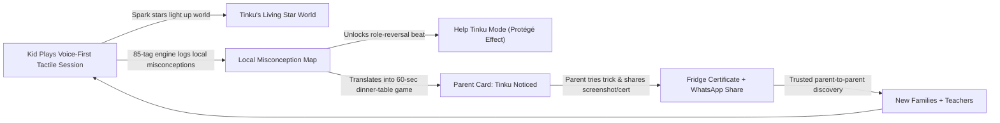

# IMPROVEMENT_PLAN.md — Consolidated Audit Findings, Product & Brand Blueprint

> **Scope (Single Source of Truth):** Consolidated, code-verified post-`L9` improvement blueprint synthesizing multiple independent product/design/code audits. Covers verified defects, kid/parent dual-audience strategy, voice-first & tactile UX, brand/IP/trademark foundations, organic audience growth, account-free ethical IAP, and mandatory child-privacy / pre-2027 Age Signals compliance gates.
> - Active UX follow-ups (`F1`–`F5`), design-system proposals (`DS-1`–`DS-8`), teacher sign-offs (`☐ 1`–`☐ 17`), and Layer 2 triggers live in [`ROADMAP.md`](ROADMAP.md).
> - Live release status, Play Data Safety answers, and the active `L9` closed-test protocol live in [`CURRENT_STATE.md`](CURRENT_STATE.md).
> - Verified code defects (`TD-1`–`TD-9`), stale flags, boundary breaches, lint warnings, and test gaps live in [`TECH_DEBT.md`](TECH_DEBT.md).
> - Historical decisions live in [`archive/decisions/DECISIONS.md`](archive/decisions/DECISIONS.md).

_Consolidated: `2026-11-20` (Day 10 of 14 of active `L9` closed test; grounded in live `src/`, Graphify knowledge graph `f060b011`, built-app visual review, and cross-checked independent reviews). **Freeze reminder:** keep engine/pacing unchanged until `L9` closes (`~2026-11-25`)._

---

## 1. Executive Verdict & High-Confidence Consensus

**Verdict:** Tinku Math's engineering and pedagogical engine are **far stronger than its visible brand and surface experience**. Very few indie kids' maths apps have 800+ automated tests, deterministic seeded recipes, 85 diagnostic misconception tags, a never-punish remediation loop, and zero Android permissions — yet almost none of that shows on the surface today.

### Five Pillars Where Independent Reviews Converged (Highest Signal)
1. **One-way offline voice is the #1 missing piece:** Grade 1 children (~5–6 years old) cannot independently read 15–18 word prompts and misconception hints. Without voice, Tinku's crown-jewel misconception engine fails silently.
2. **Surface the 85-tag misconception engine to parents ("Tinku Noticed"):** [`src/engine/mastery.js`](src/engine/mastery.js) already stores each child's exact misconception counts locally, yet [`src/components/ParentDashboard.jsx`](src/components/ParentDashboard.jsx) hides it behind generic progress dots. Turning those tags into plain-language 60-second dinner-table tips is what parents screenshot and share on WhatsApp.
3. **Turn the Home path into Tinku's actual World:** Replace the flat blue scroll and duplicate emojis with named illustrated places, custom flat-2D badges, one traveling Tinku, and persistent mastery growth — with **zero streaks and zero penalty for skipping a day**.
4. **Own one sharp positioning sentence + verifiable trust mark:** Lead with *"The maths friend that knows **why**"* paired with **No ads · No accounts · No internet · No permissions**.
5. **Depth before breadth:** Nail voice, character warmth, tactile play, and parent wow across Grades 1–2 **before** building Grade 3, kindergarten, accounts, or paywalls.

### Non-Negotiable Anti-Goals (What NOT to Build)
- **No** streaks, streak-freezes, gem/coin grind shops, cosmetic loot, leaderboards, ads, or child-facing login/paywall walls — any of these would erase Tinku's calm, trustworthy differentiation.
- **No** two-way microphone recording / speech-to-text (e.g., OpenAI Whisper / voice AI chat) in offline tiers (see §4.2 privacy guardrail).

---

## 2. Verified Live Bugs & Immediate UX Collisions (Confirmed in `src/`)

| ID / Priority | Location | Verified Finding | Fix Plan |
|---|---|---|---|
| **Bug 1 (P0)** (`TD-9`) | [`src/components/QuestionView.jsx`](src/components/QuestionView.jsx) (`group-compare`, L744–752) + [`src/recipes/compare.js`](src/recipes/compare.js) (L40–46) | **Answer leak + equal glyph sizing:** Renders `Group A ({countA})` and `Group B ({countB})`, letting the child read `(4)` vs `(6)` instead of counting and defeating Rung 2's Piaget size-conservation test (`quantity-size-illusion`). Both groups also render at identical `16px` (`text-base`), so "big" objects (`🐘`, `🍉`) look no larger than "small" ones (`🐜`, `🍓`). | Remove `({countA})` / `({countB})` from group headers; scale countable objects responsively (`clamp`) and visually differentiate large vs small objects on Rung 2; add a regression test preventing numeric count leaks. |
| **Bug 2 (P0)** (`TD-9`) | [`src/components/QuestionView.jsx`](src/components/QuestionView.jsx) (`half-collection`, L781–783) + [`src/recipes/fractionsBasic.js`](src/recipes/fractionsBasic.js) (L144–151) | **Answer leak on larger halves:** When `groupSize > 6` (e.g., *"What is 1/2 of 18 apples?"*, `groupSize = 9`), `QuestionView.jsx` highlights the first partition and literally renders `({groupSize})` — printing **`(9)`** directly on screen. | Render all items cleanly in a compact grid/array (or cap visual collection size to `<= 12` / remove the literal `({groupSize})` numeral) and add a regression guard. |
| **UX-1 (P0)** | [`src/recipes/skillMap.js`](src/recipes/skillMap.js) (L53–73) + [`src/components/SkillPathScreen.jsx`](src/components/SkillPathScreen.jsx) (L68, L167) | **Home-path collisions:** Adjacent skills repeat identical system emojis (`🎉🎉`, `➕➕`, `🎈🎈`); `🐘` (`g1.prenum.compare`) competes with Tinku; **`"Bigger or Smaller?"`** sits directly above **`"Big or Small?"`**; and **two Tinkus** appear simultaneously on the Home screen. | Keep **one** Tinku physically standing at the active node; rename `"Bigger or Smaller?"` vs `"Big or Small?"` distinctly (e.g., *"More or Fewer?"* vs *"Compare Numbers"*); remove `🐘` as a skill icon; replace emojis with custom flat-2D SVG badges (`DS-6`). |
| **UX-2 (P1)** | [`src/index.css`](src/index.css) (L217–247) | **Mascot vs. visual-stage proportion:** On `stage` visual skills (`group-compare`, `count-objects`, `pictograph`, `clock`), Tinku (`25cqh`) + reserved hint slot (`9.8cqh`) take ~35–40% of vertical space while tray items are cramped (`16px` in `group-compare`). | Keep hero Tinku on `roomy` equations, but adjust `--q-mascot` on **`stage` visual profiles** (`25cqh → ~18–20cqh`) and reallocate that vertical height directly to larger, tappable math visuals. |

---

## 3. Brand, IP, Trademark & Positioning Foundations *(Do During Phase 0 — Zero Code)*

1. **Positioning & Tagline:**
   - Replace the generic tagline (*"Maths practice, one friendly step at a time"*) with an ownable promise: **"The maths friend that knows *why*"**, paired with the verifiable seal: **No ads · No accounts · No internet · No permissions** *(update accurately before any Layer 2 build that introduces `INTERNET` / Play Billing)*.
2. **Trademark Clearance (BEFORE Brand Spend):**
   - Keep **"Tinku"** (warm, short, character-led), **after** running a formal trademark clearance search in **India** (specifically checking phonetic/visual conflict risk against **Tinkle** / Amar Chitra Katha across Classes 9, 16, 41, 42), **UAE**, and target global markets. Changing a name before launch is 100× cheaper than rebranding later.
3. **"Math" vs. "Maths" Consistency:**
   - Keep **`Tinku Math`** as the global product name ([`src/config/brand.js`](src/config/brand.js)), retain `"maths"` as a Play Store keyword (`Tinku Math: Maths for Kids`), and pick one consistent spelling across in-app UI copy.
   - Keep `"CBSE"` out of the app name and Play Store listing description per [`src/config/brand.js`](src/config/brand.js) and `brand.test.js` (curriculum alignment belongs only in optional regional parent web guides).
4. **Human-Illustrated Mascot & Copyright Ownership:**
   - Commission a **human illustrator** to draw Tinku's canonical model sheet + full written copyright/IP assignment. Purely AI-generated art carries copyrightability risk and cannot be cleanly defended if the brand grows.
   - **Signature visual hook ("Tinku's Spark"):** Make the chest star Tinku's signature **Math Spark** — glowing gently while thinking, bursting on correct answers, and lighting up constellations in his world.
   - **Low-end Android animation choice:** Implement Tinku's live reactions (blinking, ear wiggle, glancing toward tapped tiles, glowing Spark) via a **layered animated SVG** (`< 40 KB`, GPU `transform`/`opacity` only, 60 fps on budget Android) or lightweight vector Lottie — avoid heavy Rive WASM runtimes unless benchmarked cleanly on a budget device.
5. **Tinku-Derived Signature Palette (Exit Stock Tailwind Indigo):**
   - Today's Wonder palette ([`src/index.css`](src/index.css)) uses default Tailwind indigo/sky (`#f0f9ff`, `#4f46e5`, `#3730a3`, `#e0e7ff`).
   - Evolve the CSS tokens into a warmer signature palette derived from **Tinku himself** (warm slate blue-grey, soft peach/cream warmth, Spark amber) while strictly preserving the locked semantic feedback tokens (`success` green, `encourage` coral, `learn` sky, `review` teal) and WCAG AA contrast (`themeContrast.test.js`).
6. **Marketing Domain & Storefront Hygiene:**
   - **Never move the PWA off `https://tinku.stringus.com`** (changing origin wipes web `localStorage`).
   - Acquire a dedicated brand marketing domain (e.g., `tinkumath.com`, post-trademark clearance) for parent guides, teacher packs, and press, linking cleanly to the web app at `tinku.stringus.com` *(static `/guides/` pages on `tinku.stringus.com` via `navigateFallbackDenylist` also work safely in the interim)*.
   - Upgrade Play Storefront with captioned benefit screenshots, a custom feature graphic, and a crisp 20–30 second demo video showing a misconception hint + parent coaching card.

---

## 4. Out-of-the-Box Product & Pedagogy Upgrades

Lessons from breakout kids' apps (**Pok Pok**, **Synthesis Tutor**, **Khan Academy Kids**, **Duolingo Math**, **Bluey/Yoto**) all point to the same loop: **tactile calm play + voice-first independence for the child, paired with diagnostic insight + offline rituals for the parent.**

### 4.1 Voice-First Tinku — Smart Hybrid Offline Audio (< 1.5 MB, Zero Cloud)
- **Tighten kid-facing hints** in [`src/engine/hints.js`](src/engine/hints.js) to crisp, spoken 6–10 word rhythms (keep longer pedagogical explanations in the Parent Dashboard).
- **Bundle compressed Opus audio behind [`src/services/sound.js`](src/services/sound.js):**
  - **Whole warm human recordings** for all **85 hints** + **~20 Tinku emotional vocalisations** (giggle, gentle baby-elephant toot + marimba sonic logo, *"Hmm..."*, *"You did it!"*) + **~35 recurring prompt stems**.
  - **Atomic number composition (NOT 1,000 recordings):** Record **~30 atomic number clips** (`0–19`, `20..90`, `hundred`, `and`) with tight crossfades to speak dynamic numbers cleanly without bloating APK size or sounding robotic.
- Add a `>= 48×48` **Tap-to-Listen (`🔊`)** pill beside prompts so 5–6 year olds never need a parent to read aloud.

### 4.2 Privacy & Regulatory Guardrail: One-Way Audio OUTPUT Only *(CRITICAL)*
> - **ALLOWED & 100% DPDP-CLEAN (Phase 1+):** **One-way audio output** (bundled `.opus`/`.mp3` clips or local TTS playing *out of the speaker*). Uses zero microphone (`RECORD_AUDIO`), zero network (`INTERNET`), and processes zero child personal data — legally identical to existing sound effects.
> - **FORBIDDEN IN OFFLINE TIERS (Requires Full Layer 2 + Legal Counsel):** **Two-way microphone input / ASR** (e.g., OpenAI Whisper or voice AI chatbots). Recorded child voices are personal/biometric data triggering **India DPDP Act 2023 Section 9 / Rule 10** (under-18 Verifiable Parental Consent + Section 9(3) anti-profiling ban), **U.S. COPPA**, and **Google Play Families `RECORD_AUDIO` Data Safety** disclosures. Never add microphone capture without explicit DPDP counsel sign-off ([`archive/legal/questionnaire-lawyer-dpdp.md`](archive/legal/questionnaire-lawyer-dpdp.md)).

### 4.3 "Tinku Noticed" — The 60-Second Dinner-Table Parent Coach *(Highest Parent ROI)*
- *(Renamed from "Tinku's Whisper" to avoid any ambiguity with OpenAI Whisper.)*
- Reads `state.misconceptions` already saved locally by [`src/engine/mastery.js`](src/engine/mastery.js) and surfaces a calm, jargon-free card in [`src/components/ParentDashboard.jsx`](src/components/ParentDashboard.jsx) mapped 1:1 to the 85 tags:
  - `forgot-carry` → *"Tinku noticed your child adds ones well and sometimes forgets to move the extra ten over. Tonight at dinner, tie 10 toothpicks with a rubber band — whenever loose sticks pass 10, bundle them together!"*
  - `digit-reversal` → *"Sometimes reads `31` as `13`. Write two digits on sticky notes and swap them on the table to see which number buys more laddoos."*
  - `up-pan-is-heavier` → *"On scales, many 6-year-olds assume higher = heavier. Hold a heavy apple in one hand and a tissue box in the other so they feel a human balance scale."*
- **Why it spreads organically:** No free competitor tells parents *why* their child is stuck in plain language — this is the exact card parents screenshot and send to spouses and class WhatsApp groups.

### 4.4 Tactile Micro-Manipulatives Inside [`src/components/QuestionView.jsx`](src/components/QuestionView.jsx)
Upgrade 6 signature visual skills with pure-UI touch physics (zero engine rewrite):
1. **`count-objects`:** Tap each item to bounce it, play an ascending marimba note (`1, 2, 3...`), and pin a tiny count dot (cures `double-count-object`).
2. **`subtraction` (*Pop the Balloons!*):** On Rung 1, let kids tap SVG balloons to pop them before selecting how many remain.
3. **`placeValue` (*Tens and Ones*):** Tap 10 loose blocks and watch them magnet-bundle into a golden 10-rod.
4. **`moneyCoins`:** Tap each coin for a crisp clink and value highlight.
5. **`measureWeight`:** Gently rock the SVG balance scale on tap.
6. **`shapes2d`:** Let kids tap a tilted shape to spin it upright (cures `rotation-blindness`).

### 4.5 "Help Tinku!" Reverse-Teaching Mode *(The Protégé Effect)*
- At mastery milestones, flip roles: Tinku attempts a problem and makes the **exact misconception the child previously overcame** (reusing existing recipe distractors).
- Child taps *"Wait, Tinku!"* and picks the helpful tip; Tinku celebrates (*"OHHH! Thank you, teacher!"*). Kids ages 6–8 adore teaching a friendly character, cementing retention without feeling tested.

### 4.6 Tinku's Living Star World & Anti-Addiction Rest Cue
- **Persistent World:** Earned Spark stars stay visible and grow **Tinku's Wonder World** — mastering a strand illuminates interactive story props (a chiming Clock Tower, a sliceable Picnic Pizza, an Origami Kite).
- **Gentle Spaced-Rep Visual:** When a mastered skill becomes `review-due` (`--color-review` teal), its world star dims with sleepy teal sparkles (*"Tinku's Clock Star is getting sleepy — tap to brighten it!"*). Nothing is ever lost for skipping a day.
- **"Tinku Gets Sleepy" (`Tinku_Sleeping.webp`, `DS-7`):** After 3–4 sessions in one sitting (configurable in Parent Zone), Tinku yawns and suggests playing again tomorrow — a trust signature parents actively praise.

---

## 5. Screen-by-Screen UI Polish Summary

| Priority | Screen / File | Key Upgrades |
|---|---|---|
| **P0** | **Home World** ([`SkillPathScreen.jsx`](src/components/SkillPathScreen.jsx), [`skillMap.js`](src/recipes/skillMap.js)) | Single traveling Tinku on active node; compact Wonder Sky header (Grade + Spark star count); 4–5 named illustrated places (*Number Grove*, *Shape Bazaar*, *Clock Tower*, *Coin Market*); custom flat-2D SVG badges (`DS-6`); fix `Bigger or Smaller?` vs `Big or Small?` and remove `🐘` skill icon. |
| **P0** | **Quiz Stage** ([`SessionPlayer.jsx`](src/components/SessionPlayer.jsx), [`QuestionView.jsx`](src/components/QuestionView.jsx), [`index.css`](src/index.css)) | Fix `group-compare` & `half-collection` answer-leak bugs (`TD-9`); expand `← Skills` and Mute to `>= 48×48` (`F1`); add `48×48` Listen (`🔊`) pill; rebalance `stage` mascot height (`25cqh → ~18–20cqh`) to enlarge countable visuals; add tactile micro-manipulatives. |
| **P1** | **Celebration** ([`CelebrationScreen.jsx`](src/components/CelebrationScreen.jsx)) | Replace Unicode `⭐`/`☆` with glowing SVG Spark stars; animate the skill's 5 Mastery Pips filling up; on level-up/mastery make primary CTA **"Next with Tinku: [Next Skill] →"**; fix `F1` tap target on secondary button. |
| **P1** | **Parent Zone** ([`ParentDashboard.jsx`](src/components/ParentDashboard.jsx)) | Split into **Progress & Coaching** (7-day visual dot bar + **"Tinku Noticed"** cards + Zero-PII Fridge Certificate + collapsible skill list) and **Settings & Backup** (Passcode, Class, Local Multi-Child Switcher, Backup, Privacy); hide `TestPanel`/dev styling; fix `F2`/`F3` tap targets. |
| **P1** | **Tablet Frame** ([`Layout.jsx`](src/components/Layout.jsx)) | Restrict desktop phone-mockup bezel (`F4`) to `@media (hover: hover) and (pointer: fine)`; render a spacious centered Wonder canvas on touch tablets. |
| **P2** | **Local Multi-Child Profiles** | Up to 3 local on-device sibling slots (`tinku:v1:profiles` — avatar icon + grade, **no child name required** = zero PII / 100% DPDP-clean). |
| **P2** | **Design Tokens** ([`ROADMAP.md`](ROADMAP.md)) | Ship `DS-1` (`--color-on-primary`, `--color-on-success`) and `DS-5` (`--size-tap-min: 48px`) before designing any dark Explorer (Grades 4–5) palette. |

---

## 6. Organic Audience Engine & Earned Credibility (Pre-IAP Growth)

Paid ads for solo kids' apps rarely break even. Build a **4-channel parent & teacher flywheel**:
1. **Misconception Web Guides for Google + 2026 AI Search (GEO):** Publish [`misconceptions-reference.md`](misconceptions-reference.md) as 85 plain-language parent/teacher guides (*"Why your 7-year-old writes `27 + 15 = 312`"*). Structured expert guides win both organic Google traffic and citations in ChatGPT/Gemini/Perplexity answers.
2. **30-Second Parent Reels / YouTube Shorts:** Show one relatable mistake + a 30-second table trick using Tinku's flat 2D art — aimed at *parents* (the installers), not kids.
3. **Zero-Login Teacher Trojan Horse (`/teachers`):** Teachers cannot recommend login-gated or ad-filled apps. Offer a free downloadable *"Grade 1–2 Math Misconception Cheat Sheet"* PDF + a Friday parent-circular blurb.
4. **Authentic In-App Parent Sharing + Phygital Touchpoints:**
   - **Zero-PII Fridge Mastery Certificates** rendered client-side via SVG/Canvas and shared via existing `@capacitor/share` (blank crayon line or ephemeral name — never saved).
   - **Screen-free "Car-Ride Tinku" 3-minute audio math riddles** (YouTube/Spotify/WhatsApp voice notes) to build brand love outside screens.
5. **Earned Credibility:** Close all 17 teacher pedagogy sign-offs (`☐ 1–☐ 17` in [`ROADMAP.md`](ROADMAP.md)) and, with permission, credit the reviewing primary maths teacher(s) by name before claiming *"Reviewed by primary maths teachers."*

---

## 7. Ethical Future IAP Architecture & Mandatory Compliance Gates

### 7.1 Account-Free Non-Predatory IAP Design
- **Key architectural advantage:** **Google Play Billing** supports **account-free non-consumable IAPs** verified against the parent's Play Store account (`queryPurchasesAsync()`), with Google acting as Merchant of Record (absorbing Indian UPI + OIDAR GST for your UAE setup; see [`archive/decisions/DECISIONS.md`](archive/decisions/DECISIONS.md)). You can monetize with **zero user accounts, zero child PII, and zero backend servers**.
- **Value Ladder (Never Paywall Kindness):**
  - **Free Forever (*Tinku Foundations*):** Full Grade 1 starter experience (or first 2–3 chapters per grade), full 85-tag misconception hints, voice, never-punish remediation, zero ads.
  - **One-Time Family Unlock *(Primary IAP)*:** Unlocks all Grades 1–2 (+ Grade 3 when shipped), up to 3 local sibling profiles, **"Tinku Noticed"** parent coaching + custom printable weak-tag practice packs, **"Help Tinku!"** rounds, and the full Living Star World. *(Reference bands: India ₹399–₹599 one-time; UAE AED 29–49; Global \$9.99–\$14.99 — anchored against < 1 hour of math tuition.)*
  - **Phase 2 Expansion:** Separate one-time **Explorer Pack (Grades 4–5)** once built.
- **Paywall Rules:** Trigger only after proven retention (e.g., 3+ practice days or 2+ mastered skills), strictly behind [`src/components/ParentGateModal.jsx`](src/components/ParentGateModal.jsx), never interrupting a child mid-session, and never paywalling hints, voice, or gentler remediation.

### 7.2 Mandatory Age Signals API & Pre-Layer-2 Compliance Gate *(Before January 2027)*

> **Trigger condition (CRITICAL):** Mandatory age-assurance signal-sharing laws take effect **before January 2027** — specifically **California AB 1043 (Digital Age Assurance Act)**, **Alabama HB 161 (App Store Accountability Act)**, and **Brazil Digital ECA** (plus any new regional child-signal laws).
> - **Current Zero-Network MVP:** Play Billing, accounts, cloud sync, and analytics are deferred to Layer 2 ([`ROADMAP.md`](ROADMAP.md)); MVP collects zero data and takes no payments.
> - **Required Gate if U.S./Brazil remain enabled AND you introduce Play Billing (IAP), accounts, cloud sync, analytics, or significant updates affecting minors:**
>   1. **Google Play Age Signals API Review & Integration:** Handle returned age bands, parental approval / revocation callbacks, and Play's mandatory-jurisdiction check method.
>   2. **Play Console "Significant Changes" Reporting:** Report material minor-affecting updates (introducing IAP, accounts, or privacy-policy/data changes) to support parental re-approval where required.
>   3. **Country-Availability Option:** Either close Age Signals integration prior to **January 2027** or scope initial Layer 2 rollout to markets where compliance gates are complete.
>   4. **Full Stacked Layer-2 Gate (All Required Together):**
>      - **Google Play Age Signals API** review (CA AB 1043, AL HB 161, Brazil Digital ECA, and emerging laws)
>      - **India DPDP Act 2023 / Rules 2025** legal counsel review (including Gazette PDF `G.S.R. 846(E)` if any child personal data is processed)
>      - **`INTERNET` & `BILLING` permission impact** review (`androidProject.test.js` + merged manifest audit)
>      - Updated [`src/config/privacyPolicy.js`](src/config/privacyPolicy.js), Play **Data Safety** form, and **Designed for Families** declarations
>      - **UAE ↔ India CA / tax residency** verification ([`archive/ops/questionnaire-ca-tax-uae-india.md`](archive/ops/questionnaire-ca-tax-uae-india.md))

---

## 8. Consolidated Phased Execution Roadmap

### Phase 0 — Zero-Code Brand/Legal Prep & `L9` Harvest *(Now → ~Nov 25, 2026: L9 Days 10–14)*
- Keep engine/pacing frozen while `L9` completes.
- Run **trademark clearance search** (`Tinku` / `Tinku Math` vs. `Tinkle` in India + UAE/US) before locking domain/merch.
- Lock **one-sentence positioning**, **"Math" vs. "maths"** copy rule, and **human illustrator brief** (model sheet + layered vector SVG + full IP assignment).
- Add 3 Day-14 tester debrief questions: *(1) Did your child need prompts/hints read aloud? (2) What made them smile or lose interest? (3) Would a 60-second dinner-table parent tip for their specific mistakes be useful?*
- Close remaining `L5` phone walk checks, settle `L7` `allowBackup` Data Safety alignment, and draft the first 5 public misconception guides.

### Phase 1 — Fix Leaks, Give Tinku Voice, Tactile Play & Parent Wow *(Weeks 1–4 Post-L9)*
1. **Immediate Correctness Fixes (`TD-9`):** Fix `group-compare` and `half-collection` answer-leak bugs + glyph sizing in [`src/components/QuestionView.jsx`](src/components/QuestionView.jsx) with regression tests.
2. **One-Way Offline Voice-First Tinku:** Shorten kid hints in [`src/engine/hints.js`](src/engine/hints.js), bundle compressed Opus voice clips (~85 hints + ~35 stems + ~20 Tinku reactions + ~30 atomic number clips) behind [`src/services/sound.js`](src/services/sound.js), and add a `48×48` Listen (`🔊`) button on prompts. *(Zero microphone / `RECORD_AUDIO`.)*
3. **Brand & UI Overhaul (Depth in Grades 1–2):**
   - Swap in human-illustrated layered SVG Tinku + Tinku-derived custom palette tokens + glowing chest **Spark**.
   - Refactor [`src/components/SkillPathScreen.jsx`](src/components/SkillPathScreen.jsx): single traveling Tinku, 4–5 named Story Places, custom flat-2D SVG medallions (`DS-6`), rename `Bigger or Smaller?` vs `Big or Small?`, remove `🐘` icon.
   - Upgrade [`src/components/CelebrationScreen.jsx`](src/components/CelebrationScreen.jsx) (SVG Spark stars, animated mastery pips, smart "Next with Tinku" CTA), rebalance `stage` mascot/tray height in [`src/index.css`](src/index.css), fix `F1`–`F3` `< 48 dp` controls, and fix `F4` tablet layout in [`src/components/Layout.jsx`](src/components/Layout.jsx).
4. **3 Signature Tactile Manipulatives:** Tap-to-count marimba objects (`count-objects`), poppable subtraction balloons, and spin-to-check shapes (`shapes2d`).
5. **Ship "Tinku Noticed" Parent Coach:** Surface `state.misconceptions` in [`src/components/ParentDashboard.jsx`](src/components/ParentDashboard.jsx) with 60-second offline dinner-table activities and move Settings/TestPanel into a clean secondary tab.

### Phase 2 — Living World, Siblings, Teacher Sign-Off & Organic Flywheel *(Months 2–3)*
1. **Tinku's Living Star World** (persistent mastery props + sleepy teal review-due stars) + **`Tinku_Sleeping` rest cue** (`DS-7`) + **"Help Tinku!"** reverse-teaching beats.
2. **Local Multi-Child Profiles** (up to 3 siblings, zero PII) + **Zero-PII Fridge Mastery Certificates** (`@capacitor/share`).
3. **Close all 17 teacher pedagogy sign-offs (`☐ 1–☐ 17`)** with named reviewer credit (with permission).
4. **Organic Distribution & Storefront Launch:** Dedicated marketing domain (post-trademark check) hosting 25+ Misconception Guides + Teacher Pack, weekly 30-sec parent misconception Reels/Shorts, and upgraded Play Store screenshots + demo video.
5. **Tech-Debt Hygiene:** Clear `TD-1`–`TD-8` in [`TECH_DEBT.md`](TECH_DEBT.md) (especially `TD-2` `AuthContext.jsx` boundary and `TD-3` Capacitor back-button seam).

### Phase 3 — Grade 3, Account-Free Ethical IAP & Pre-2027 Compliance Gate *(Months 4–6 / Before Jan 2027)*
1. Ship **Grade 3 curriculum** + custom printable misconception worksheets.
2. Close the full **Pre-Layer-2 Compliance Gate (§7.2)** — **Google Play Age Signals API** (CA AB 1043, AL HB 161, Brazil Digital ECA before January 2027 if U.S./Brazil enabled), DPDP legal check, `INTERNET`/`BILLING` permissions, Data Safety, Designed for Families, and UAE ↔ India tax verification.
3. Launch **Account-Free Google Play Billing** (`One-Time Family Unlock`) behind [`src/components/ParentGateModal.jsx`](src/components/ParentGateModal.jsx), followed by Capacitor iOS release.

---

## 9. Decisions to Lock Before Phase 1 Starts

1. **Trademark & Name Check:** Clear `Tinku` / `Tinku Math` (especially against `Tinkle` in India) during Phase 0 before buying the marketing domain or commissioning brand packaging.
2. **Human Illustrator & Audio Production:** Confirm budget/approach for (a) human-illustrated layered SVG Tinku model sheet with full IP assignment, and (b) ~1–1.5 MB bundled offline Opus voice pack (**one-way output only**).
3. **First Beachhead Market:** Lead organic parent guides & short videos with **India + UAE/NRI parents** first or **global English-speaking Montessori/homeschool parents**?
4. **Bug-Fix Timing (`TD-9`):** Fix the verified `group-compare` and `half-collection` answer-leak bugs immediately on a branch ready for Day 15 (post-`L9`), or patch the web PWA sooner?
5. **Monetization Model:** Confirm **account-free One-Time Family Unlock** (multi-sibling local slots, zero login, zero DPDP child-data processing) vs. recurring subscriptions.
